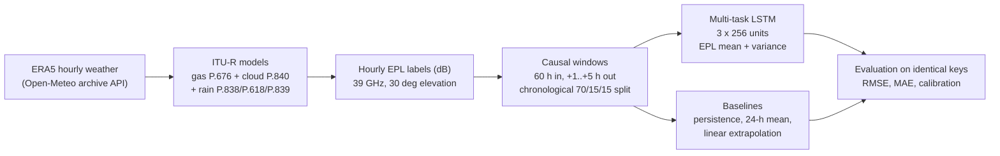
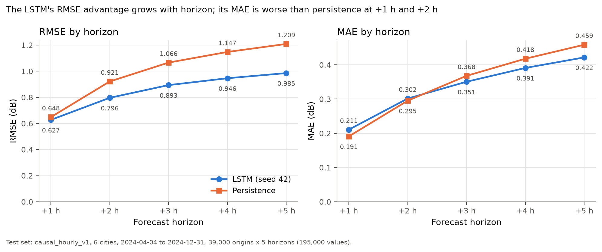
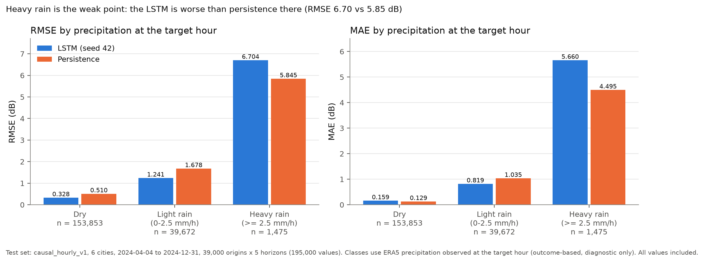
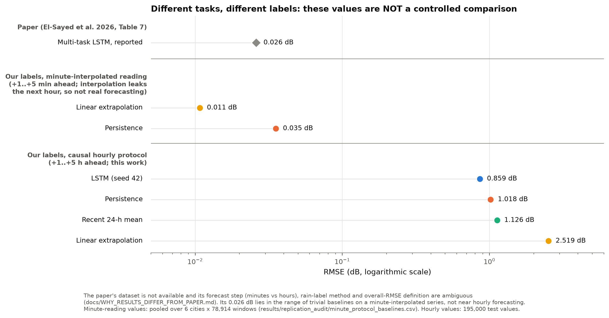

# Forecasting 39 GHz LEO satellite path loss from weather: an independent implementation

This repository is an independent implementation and evaluation inspired by

> S. A. El-Sayed, M. Ibrahim, H. El-Hennawy, E. S. Abbas, "Prediction of channel
> propagation impairments in LEO satellite networks using machine learning",
> *EURASIP Journal on Wireless Communications and Networking* 2026:102,
> doi:[10.1186/s13638-026-02667-w](https://doi.org/10.1186/s13638-026-02667-w).

## The problem

Signals between a ground station and a low Earth orbit (LEO) satellite at Q-band
(39 GHz) are weakened by the atmosphere: oxygen and water vapour, cloud water
and, above all, rain. If this **excess path loss (EPL)** can be forecast a few
hours ahead, a link can adapt its margin, modulation or routing before a fade
arrives.

**What the system predicts.** For each of six European sites (Athens, Bergen,
Budapest, Chilbolton, Vigo, Warsaw), it takes the past **60 hours** of weather
and attenuation features and forecasts EPL in dB at **+1, +2, +3, +4 and +5
hours**. For each value it outputs a mean and an uncertainty (a Gaussian
standard deviation).

**What it does not predict.** It does not forecast measured satellite received
power. Its "true" EPL values are **reconstructed labels**: ITU-R propagation
models applied to ERA5 reanalysis weather. No satellite measurement is involved.

## Pipeline



* **Data:** hourly ERA5 weather for 2020-2024 (temperature, humidity,
  dewpoint, surface pressure, precipitation, rain, cloud cover).
* **Labels:** EPL = gas + cloud + rain attenuation, computed with the `itur`
  library and our own code (`physics/build_attenuation.py`). The cloud term
  uses a liquid-water proxy that we fitted ourselves, because the paper gives
  no formula.
* **Inputs:** 14 features per hour: location, 5 weather variables, gas, cloud
  and rain attenuation with their 24-h rolling standard deviations, and
  elevation.
* **Model:** `multitask_fig1heads`, as drawn in the paper's Fig. 1, with
  1,468,707 parameters.
  * Encoder: 3 stacked LSTM layers of 256 units, with dropout 0.2.
  * Weather head: forecasts 5 weather variables x 5 hours (MSE loss).
  * EPL head: 5 means and 5 log-variances (Gaussian negative log-likelihood).
* **Training:** Adam (learning rate 1e-4), batch 128, early stopping on
  validation loss (patience 6), seed 42.
* **Baselines:** on exactly the same test keys:
  * persistence: repeat the current EPL;
  * the mean of the last 24 hours;
  * linear extrapolation from the last two hours.

## Main result: causal hourly evaluation (`causal_hourly_v1`)

* **Inputs:** only data up to the forecast time.
* **Splits:** chronological per city, separated by gaps of at least 65 hours
  (60 h input + 5 h horizon), so no hour is shared between splits.
* **Scalers:** fitted on training data only.
* **Test set:** 6 cities, 2024-04-04 to 2024-12-31, **39,000 forecast origins
  x 5 horizons = 195,000 target values**.

| Method | RMSE (dB) | MAE (dB) |
|---|---|---|
| **LSTM** (`multitask_fig1heads`, seed 42; best epoch 5 of 11) | **0.859** | **0.335** |
| Persistence | 1.018 | 0.346 |
| Recent 24-h mean | 1.126 | 0.494 |
| Linear extrapolation | 2.519 | 0.718 |

* **Improvement over persistence**, computed as (persistence - LSTM) /
  persistence:
  * RMSE: (1.0181 - 0.8592) / 1.0181 = **15.6 %** lower;
  * MAE: (0.3461 - 0.3350) / 0.3461 = **3.2 %** lower.
* **By horizon:** the RMSE gain grows from 0.02 dB at +1 h to 0.22 dB at
  +5 h.
* **By city:** RMSE is lower in all six cities.
* Source: `results/causal_hourly_fig1heads_seed42/metrics_test.json`.

**Known weaknesses:**
* **Heavy rain** (>= 2.5 mm/h at the target hour): the LSTM is **worse** than
  persistence (RMSE 6.70 vs 5.85 dB), and rain peaks are strongly
  under-predicted.
* **Uncertainty:** nominal 95 % intervals cover 97.4 % of all values, but
  only **46 %** of heavy-rain values. Good overall coverage hides poor
  conditional calibration.
* **Short horizons:** MAE is worse than persistence at +1 h and +2 h.
* **One seed only:** robustness across seeds has not been measured.




More figures: [overall baselines](docs/assets/figures/causal/06_baseline_comparison.png),
[calibration](docs/assets/figures/causal/09_calibration_reliability.png). All
13 figures with explanations: **[docs/VISUAL_RESULTS_GUIDE.md](docs/VISUAL_RESULTS_GUIDE.md)**.

### The paper's 0.026 dB is not comparable

The paper reports RMSE 0.026 dB. We do not treat this as a target:
* The task differs. The paper's figures point to a minute-interpolated series
  forecast minutes ahead, while its text says 5 hours.
* The labels differ. Ours reach 25.6 dB; the paper's plots stop near 6.7 dB.
* Its own Table 7 overall value does not follow from its per-city values.

On a minute-interpolated version of *our* labels, no-model baselines already
score 0.011-0.035 dB. No implementation bug was found (units verified in dB).
Details: **[docs/WHY_RESULTS_DIFFER_FROM_PAPER.md](docs/WHY_RESULTS_DIFFER_FROM_PAPER.md)**.



## Documentation

| Document | Purpose |
|---|---|
| [docs/PROJECT_EXPLAINED_FROM_SCRATCH.md](docs/PROJECT_EXPLAINED_FROM_SCRATCH.md) | Full explanation for learning |
| [docs/VISUAL_RESULTS_GUIDE.md](docs/VISUAL_RESULTS_GUIDE.md) | Every figure, its key result and how to read it |
| [docs/CAUSAL_HOURLY_MODEL_EXPERIMENT.md](docs/CAUSAL_HOURLY_MODEL_EXPERIMENT.md) | The main experiment: audit, configuration, results |
| [docs/CAUSAL_FORECASTING_INVESTIGATION.md](docs/CAUSAL_FORECASTING_INVESTIGATION.md) | Why the causal protocol was chosen; leakage analysis |
| [docs/WHY_RESULTS_DIFFER_FROM_PAPER.md](docs/WHY_RESULTS_DIFFER_FROM_PAPER.md) | Ranked explanation of the gap to 0.026 dB |
| [docs/REPLICATION_GAP_AUDIT.md](docs/REPLICATION_GAP_AUDIT.md), [docs/RAIN_LABEL_DIAGNOSTIC.md](docs/RAIN_LABEL_DIAGNOSTIC.md) | Paper-vs-code audit; check of the rain labels |
| [docs/FINAL_RESEARCH_REPORT.md](docs/FINAL_RESEARCH_REPORT.md), [REPLICATION.md](REPLICATION.md) | Earlier full report and methodology (stratified protocol) |
| [docs/JANUARY_PROXY_EXPERIMENT.md](docs/JANUARY_PROXY_EXPERIMENT.md) | First prototype (Athens, January 2020); kept as evidence, not comparable |

## Setup (Windows, Python 3.12)

```powershell
py -3.12 -m venv .venv
.venv\Scripts\python -m pip install -r requirements.txt
```

[requirements.txt](requirements.txt) pins the versions that produced the
results (TensorFlow 2.21 on CPU). A fresh install on a second machine has not
been tested.

## Verify and explore (lightweight, no training)

These commands need the local `data/processed/` folder and the saved
predictions in `results/`, which are git-ignored and are not in a fresh clone.
A clone contains only the small result files (metrics, configs, figures,
audit outputs); tests that need the missing data skip themselves.

```powershell
# unit and leakage tests (41 tests, about 10 s)
.venv\Scripts\python -m unittest discover -s tests

# recompute every causal metric from the saved predictions, check it against
# metrics_test.json, and redraw the 13 figures (about 15 s)
.venv\Scripts\python evaluation\plot_research_results.py --overwrite --export-docs
```

The plotting script stops with an error if the recomputed metrics or test keys
differ from the saved ones. Without `--overwrite`, it refuses to write into an
existing `results\figures\`.

## Reproduce from scratch

Data, checkpoints and prediction files are not in the repository (they are
large and regenerable).

**Before you start: move the committed outputs aside.** The repository
includes the published outputs of the main run as a reference. The causal
scripts and `why_results_differ.py` refuse to overwrite an existing output
folder, so in a fresh clone they would stop with "exists; not overwriting".
Move these four folders outside the repository first (PowerShell, repository
root), and compare your new outputs with them afterwards:

```powershell
New-Item -ItemType Directory ..\leo-published-results | Out-Null
Move-Item results\causal_baseline_audit, results\causal_hourly_fig1heads_seed42, results\figures, results\why_results_differ ..\leo-published-results\
```

`git status` then shows these files as deleted; `git restore results` puts
them back. The scripts behind `results\replication_audit\` overwrite their
files in place, so `git diff` shows any difference from the published
version. `--export-docs` also replaces the five PNGs in
`docs\assets\figures\causal\`.

* **Causal experiment (main result).** It needs the earlier pipeline first:
  the baselines step reads the earlier protocol's `results\paper\metrics_test.json`
  and the minute-level dataset, and both are produced only by step 1.
  1. `.\run_pipeline.ps1 -Download`: downloads the weather data, builds the
     ITU-R labels and datasets, and trains and evaluates the whole earlier
     protocol (15 runs of about 1-2.5 h each on CPU).
  2. `.venv\Scripts\python evaluation\evaluate_causal_baselines.py`: baselines
     and test keys.
  3. `.venv\Scripts\python training\train_causal_hourly.py`: about 3 h on CPU
     (11 epochs).
  4. `.venv\Scripts\python evaluation\evaluate_causal_model.py`.
  5. `.venv\Scripts\python evaluation\plot_research_results.py`.
* **Earlier stratified protocol only:** `.\run_pipeline.ps1 -Download` (step 1
  above). `-EvaluateOnly` re-evaluates existing checkpoints and regenerates
  `results\paper\`.
* **Not verified:** these sequences were run step by step in this workspace,
  never as a whole from an empty folder. Open-Meteo responses may change
  slightly over time.
* **Determinism:** training is deterministic on this machine (TensorFlow op
  determinism, seed 42). Other hardware or library versions may give
  different numbers.
* **LWP proxy:** re-fitting it needs ERA5 files from the Copernicus Climate
  Data Store (free account, `~/.cdsapirc`) in `data\raw\era5\`. The committed
  fit used Athens 2020-2024 and Bergen 2020-01 to 2021-02, downloaded one
  month at a time with `data_pipeline\build_dataset.py` (for example
  `--city Athens --year 2020 --start-month 1 --end-month 12`). Without these
  files, the committed coefficients in `physics/lwp_proxy_calibration.json`
  are used.
* **Laptops:** keep it plugged in with the lid open during training, because
  standby pauses training.

## Earlier results: stratified hourly protocol (historical)

Before the causal protocol, models were trained on 10,000 stratified hourly
samples per city. Test set: Apr-Dec 2024, 8,916 windows x 5 h. Mean +- std
over seeds 42, 1 and 2:

| Model | RMSE (dB) |
|---|---|
| Multi-task LSTM, Fig. 1 heads | 0.916 +- 0.006 |
| Multi-task LSTM (main) | 0.940 +- 0.004 |
| Without ITU-R features (Table 10 ablation) | 0.940 +- 0.006 |
| EPL-only (Table 9 ablation) | 0.946 +- 0.007 |
| Persistence | 1.042 |

These numbers use a **different test set** and are kept for the ablations,
seed variation and unseen-city experiments
([docs/FINAL_RESEARCH_REPORT.md](docs/FINAL_RESEARCH_REPORT.md)). Do not
pool them with the causal results.

## Repository layout

| Path | Contents |
|---|---|
| `config.py` | All settings, tagged [PAPER] or [OURS] |
| `data_pipeline/` | Downloads (`download_openmeteo.py`), dataset builders; causal windows in `causal_forecast_source.py` |
| `physics/` | ITU-R labels (`build_attenuation.py`), LWP proxy fit and coefficients |
| `training/` | Model and loss (`train_paper_model.py`), causal training (`train_causal_hourly.py`), run queues |
| `evaluation/` | Metrics, baselines, figures (`plot_research_results.py`), audits, paper comparison |
| `tests/` | Unit and leakage tests (`unittest`): `test_pipeline.py`, `test_causal.py` |
| `docs/` | Reports, guides and a curated figure snapshot (`docs/assets/`) |
| `results/` | Generated outputs. Only the small files cited by the docs are in Git: `figures/` (13 PNG + PDF, manifest), the main run's metrics and config, baseline metrics, and the replication-gap analysis. Predictions stay local |
| `models/`, `data/` | Checkpoints and data (git-ignored) |

Two older groups of scripts are not part of the pipeline above:
* **ERA5 download from the Copernicus CDS** (`data_pipeline/download_era5.py`,
  `prepare_era5_weather.py`, `build_dataset.py`). They are needed only to
  re-fit the LWP proxy (see above).
* **The first prototype** (Athens, January 2020, proxy labels): the scripts
  listed in [docs/JANUARY_PROXY_EXPERIMENT.md](docs/JANUARY_PROXY_EXPERIMENT.md),
  plus `models/lstm_baseline.py`, `models/multitask_lstm.py`,
  `training/prepare_data.py` and `training/prepare_multitask_data.py`. They are
  not maintained.

## Data and attribution

Weather data by [Open-Meteo.com](https://open-meteo.com/) (CC BY 4.0), based on
ERA5 reanalysis (Copernicus Climate Change Service). ITU-R models via ITU-Rpy
(`itur`). The paper is cited above and licensed CC BY-NC-ND 4.0; its PDF and
figures are not included here. Full references: [docs/REFERENCES.md](docs/REFERENCES.md).
No licence has yet been chosen for this repository's own code.
