# Forecasting Q-band LEO satellite path loss from weather with a multi-task LSTM: a partial replication

*Independent replication study of El-Sayed et al. (2026). Report date: 26 October 2026.
All numbers come from files in this repository (`results/paper/`, snapshot in
`docs/assets/`); paper values are labelled as references.*

> **Note (2026-10-27):** this report covers the earlier **stratified** hourly
> protocol. The current main result is the strictly causal evaluation
> (RMSE 0.859 vs persistence 1.018 dB on a different test set):
> [CAUSAL_HOURLY_MODEL_EXPERIMENT.md](CAUSAL_HOURLY_MODEL_EXPERIMENT.md),
> [PROJECT_FINAL_STATUS.md](PROJECT_FINAL_STATUS.md).

## Abstract

El-Sayed et al. (2026) report that a coordinate-aware multi-task LSTM forecasts
the excess path loss (EPL) of a 39 GHz Earth-satellite link five hours ahead
with an RMSE of 0.026 dB at six European training cities and an average error
of 0.213 dB at ten unseen cities. We rebuilt the pipeline from public data:
hourly ERA5 weather from Open-Meteo, ITU-R attenuation labels, the paper's
dataset construction, model, loss and training settings. On a strict
chronological test period (April-December 2024) the model reaches
0.940 +- 0.004 dB RMSE (three seeds); a variant with the extra head layer drawn
in the paper's Fig. 1 reaches 0.916 +- 0.006 dB. Simply repeating the current
EPL (persistence) gives 1.042 dB and still beats the LSTM at one hour ahead.
The paper's 0.026 dB was therefore **not reproduced**; we show that errors of
that size are reached trivially on minute-interpolated data, which is one
reading of the paper's Fig. 2. The paper's ablation conclusions were not
reproduced either: ITU-R-derived input features gave no measurable gain and
multi-task training gave at most a small EPL gain while worsening the weather
forecast. For unseen cities, the paper's neighbour-synthesis method matches
its reported "average error" when measured the paper's way, but its hourly
errors are worse than local persistence. Using mean-sea-level instead of
surface pressure removed large failures at two high-altitude cities. The
model's 95 % intervals cover 96.6 % of outcomes overall but only 37 % during
heavy rain. This is a partial replication: the authors' dataset was not
available and several method details are unspecified.

## 1. Research question and motivation

LEO satellite links at Q-band (here 39 GHz) suffer weather-dependent
attenuation from atmospheric gases, clouds and rain. Forecasting it a few
hours ahead could support link adaptation. The questions were:

1. Can the paper's multi-task LSTM forecast EPL 1-5 h ahead with the reported accuracy?
2. Do the paper's design choices (ITU-R input features, multi-task training) help?
3. Does the model generalise to unseen cities as reported?
4. Are its uncertainty estimates useful?

## 2. The paper and its claims (reference values)

| Claim (El-Sayed et al. 2026) | Reported value |
|---|---|
| EPL RMSE at six training cities, 5-h horizon | 0.026 dB (MAE 0.009 dB) |
| 95 % interval coverage (PICP) | 99.23 % |
| Average error at ten unseen cities | 0.213 dB |
| Without ITU-R features (Table 10) | RMSE 0.028 dB |
| EPL-only model (Table 9) | RMSE 0.015 dB; multi-task improves weather RMSE 0.892 -> 0.761 |

The paper's text describes a 60-step history and a 5-hour horizon, while its
Fig. 2 describes 1-minute sampling and a 5-step horizon. Its Table 2 lists
mean-sea-level pressure while Sect. 3.1 says surface pressure. The cloud
liquid-water proxy, uncertainty-feature formulas, elevation and polarisation
are not specified (full list: REPLICATION.md Sect. 3).

## 3. Data and preprocessing

* **Weather:** hourly ERA5 reanalysis via the Open-Meteo archive API,
  2020-2024, for Athens, Bergen, Budapest, Chilbolton, Vigo and Warsaw
  (43,848 hours per city, no gaps); 2023-2024 for ten unseen cities (Berlin,
  Oslo, Rome, Stockholm, Bucharest, London, Davos, Paris, Marseille, Madrid);
  mean-sea-level pressure for all 16 cities.
* **Samples:** 10,000 anchor hours per city, stratified over the 288
  (month, hour-of-day) strata, seed 42.
* **Windows:** 60 hourly input steps (t-59..t) of 14 features; targets are
  EPL and five weather variables at t+1..t+5.
* **Split:** chronological 70/15/15 per city, with a 65-hour purge gap so no
  hour is shared between splits; test period about 24 March-31 December 2024
  (8,916 windows). Feature and weather scalers are fitted on training
  windows only. These properties are checked by automated tests.

## 4. Physical attenuation labels and features

EPL = gas + cloud + rain attenuation at 39 GHz, 30 deg elevation, circular
polarisation, using `itur` 0.4.0:

* **Gas:** ITU-R P.676-12 specific attenuation at the measured surface state x
  equivalent heights / sin(elevation).
* **Cloud:** ITU-R P.840-8 with a liquid-water-path proxy
  `LWP = a * clip((RH - 65)/35, 0, 1) + b * precipitation`, fitted by us to
  ERA5 total column cloud liquid water (a = 0.101 kg/m^2, b = 0.144 kg/m^2 per
  mm). The fit is weak: R^2 0.41 in-sample, about 0 on held-out years
  (correlation 0.38). The paper gives no formula.
* **Rain:** ITU-R P.838-3 + P.618-13 (steps 1-9) + P.839-4 rain height, with
  the hourly ERA5 liquid rain used as the rain rate.

Mean EPL is 0.9-1.7 dB per city; gas contributes about 0.75 dB everywhere and
rain causes almost all variability (maxima 16.7-25.6 dB). The 14 inputs are
latitude, longitude, temperature, relative humidity, pressure, precipitation,
cloud cover, the instantaneous gas/cloud/rain attenuation ("mu"), their
trailing 24-h standard deviations ("sigma"), and the (constant) elevation.

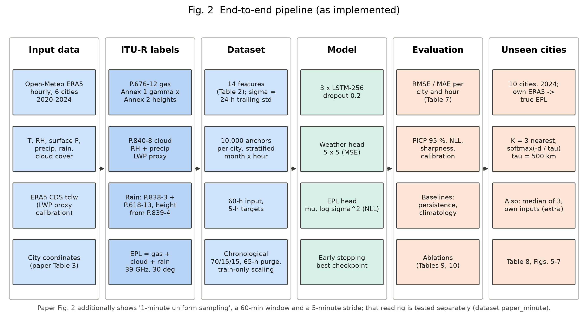

## 5. Model and training

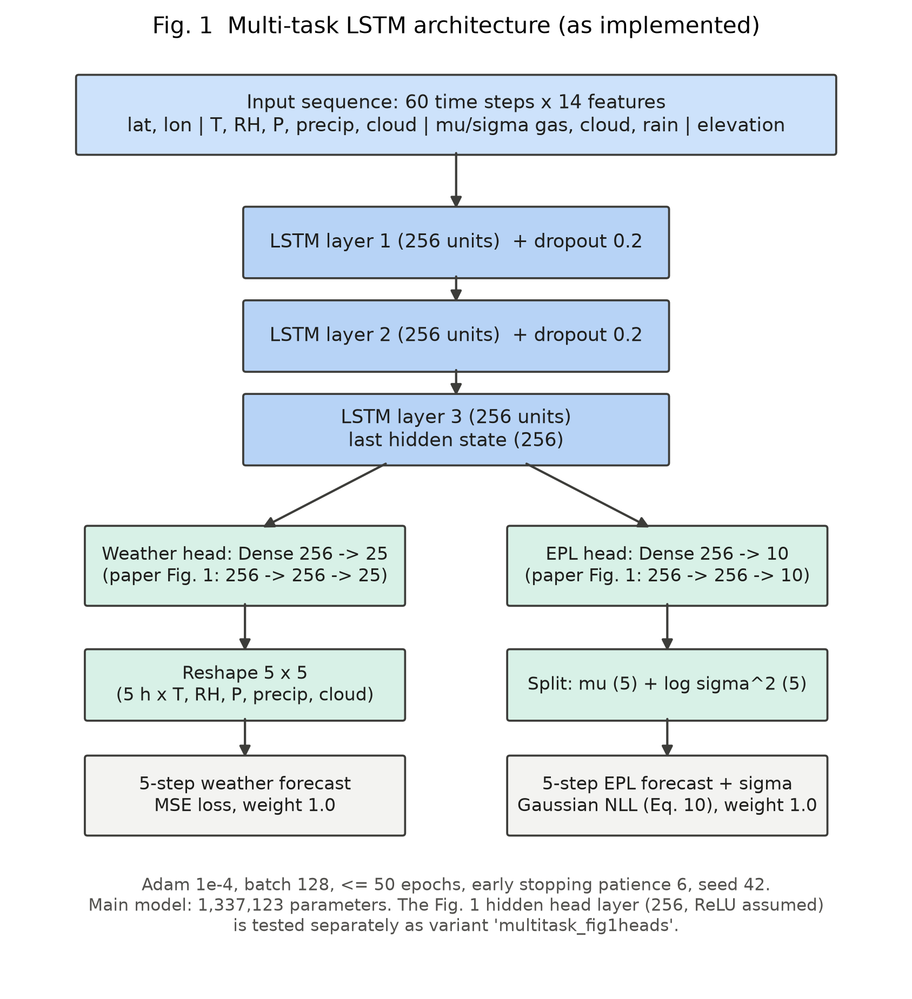

* 3 stacked LSTM layers of 256 units, dropout 0.2 between layers (1.34 M parameters).
* Weather head: Dense -> 5 hours x 5 variables, MSE loss on standardised targets.
* EPL head: Dense -> 5 means + 5 log-variances, Gaussian negative
  log-likelihood (paper Eq. 10), log-variance clipped to [-12, 6].
* `multitask_fig1heads`: adds a Dense(256, ReLU) layer in each head, as drawn
  in the paper's Fig. 1 (1.47 M parameters).
* Adam (learning rate 1e-4), batch 128, up to 50 epochs, early stopping on
  validation loss with patience 6, best weights restored; TensorFlow op
  determinism; seeds 42, 1 and 2.
* Ablations: `epl_only`, `weather_only`, `no_itu` (8 inputs); extra
  experiments `multitask_msl` (MSL pressure) and `minute_multitask`
  (Fig. 2 reading). 15 runs in total, all completed.

## 6. Evaluation design

* RMSE and MAE in dB over all windows and the five horizons, per city and per
  hour (paper Table 7 layout).
* Uncertainty: PICP of mu +- 1.96 sigma, NLL, sharpness (mean sigma), and
  conditional coverage by weather class and EPL level.
* Baselines on the same windows: persistence (EPL at t repeated), climatology
  (city x month x hour mean of the training period); for the minute data,
  persistence and linear extrapolation of the last minute.
* Unseen cities: forecasts for every hour from 9 April to 31 December 2024
  (6,385 per city) with inputs synthesized from the three nearest training
  cities (softmax(-d/tau) weights, tau = 500 km; also a median-of-3 variant)
  and, as an extra check, with each city's own weather.
* Independent audit script recomputing every metric from saved predictions
  (127/127 checks pass) and 12 unit/data-integrity tests (all pass).

## 7. Results

### 7.1 Six cities, chronological test set

| Model | RMSE (dB), seeds 42/1/2 | MAE (dB) | Hour-1 RMSE (dB) |
|---|---|---|---|
| Multi-task LSTM | 0.940 +- 0.004 | 0.349 | 0.708 |
| Multi-task, Fig. 1 heads | **0.916 +- 0.006** | 0.343 | 0.643 |
| Persistence | 1.042 | 0.352 | **0.596** |
| Climatology | 1.235 | 0.590 | - |
| *Paper (reference)* | *0.026* | *0.009* | *0.026* |

* RMSE grows with horizon (seed-42 main model 0.70 -> 1.04 dB from hour 1 to
  5); persistence grows faster (0.60 -> 1.25 dB), so the LSTM wins from hour 2.
* Per city (seed 42, main / Fig. 1 heads / persistence): Athens 0.62 / 0.62 /
  0.68, Bergen 0.83 / 0.82 / 0.98, Budapest 1.08 / 1.06 / 1.31, Chilbolton 0.80 /
  0.80 / 0.98, Vigo 1.30 / 1.21 / 1.26, Warsaw 0.84 / 0.83 / 0.91 dB. In Vigo the
  main model is worse than persistence.
* By weather at the target hour (main model / persistence RMSE): clear 0.14 /
  0.19, cloudy 0.39 / 0.53, light precipitation 1.25 / 1.71, >= 2.5 mm/h
  7.96 / 6.60 dB. The model never predicts more than 5.8 dB (Fig. 1 heads:
  8.3 dB), while 32 test windows exceed 14 dB; only 66 of 42,000 training
  windows do.

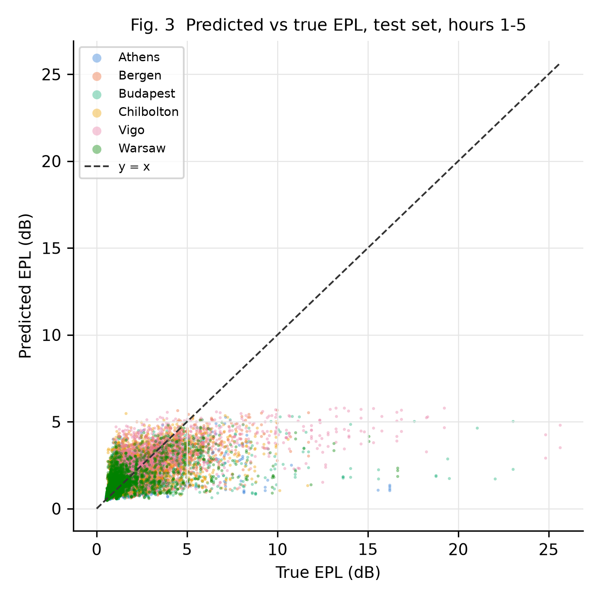
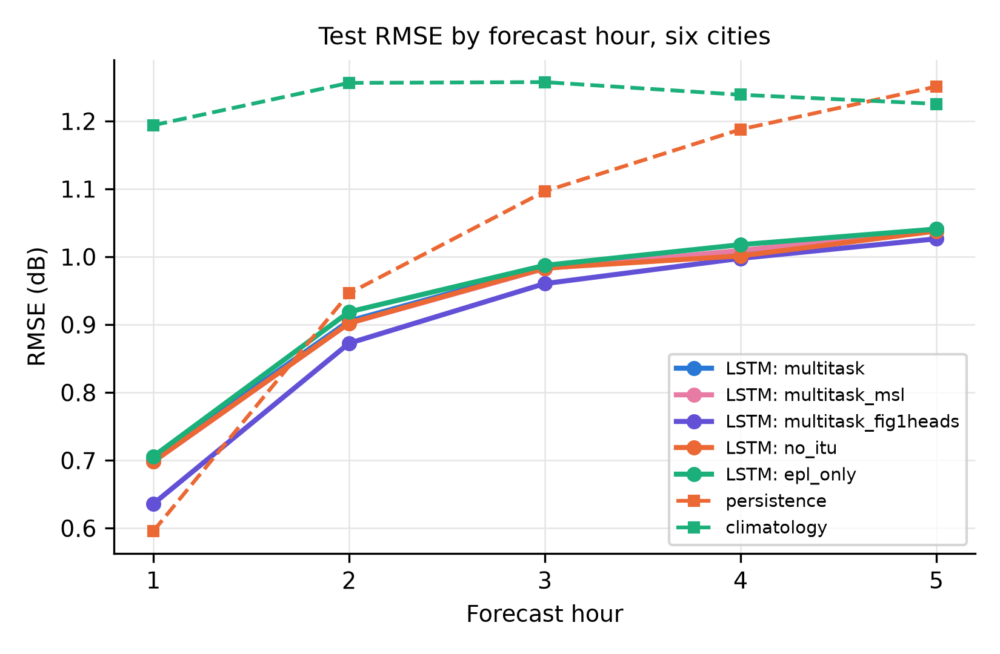
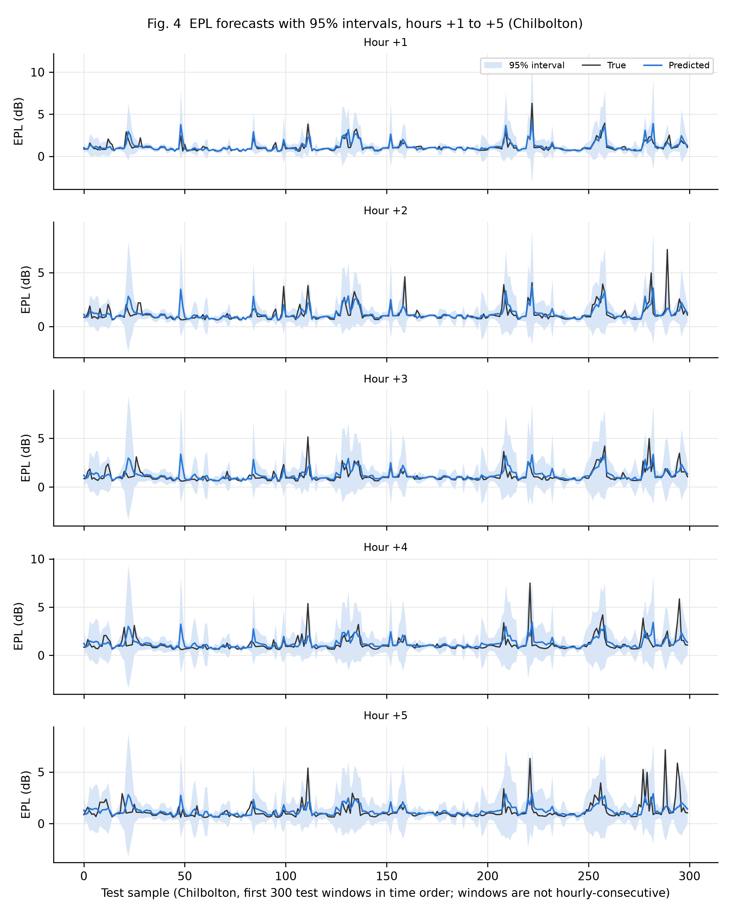
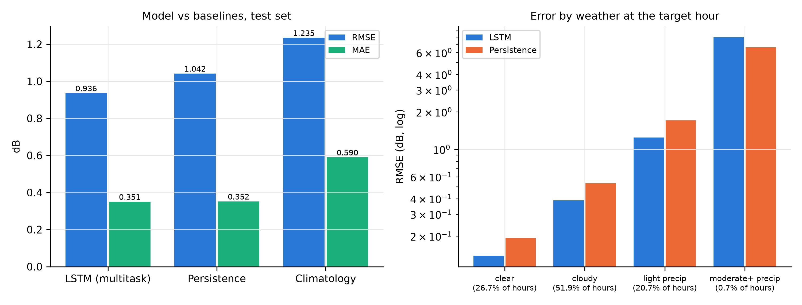

### 7.2 Ablations and repeated seeds

| Comparison (A - B, same seed) | Per-seed differences (dB) | Mean +- std | Reading |
|---|---|---|---|
| Fig. 1 heads - main, RMSE | -0.021, -0.025, -0.026 | -0.024 +- 0.003 | consistent improvement |
| Fig. 1 heads - main, hour-1 RMSE | -0.062, -0.064, -0.067 | -0.064 +- 0.002 | consistent improvement |
| Main - EPL-only, RMSE | -0.001, -0.010, -0.006 | -0.006 +- 0.005 | small, same sign; not established |
| No ITU-R features - main, RMSE | +0.005, -0.002, -0.003 | -0.000 +- 0.004 | no effect |

* Weather forecast (standardised RMSE): weather-only 0.480 (one seed) vs
  multi-task 0.525 +- 0.007 (three seeds); for example temperature 1.31 vs
  1.86 degC. The paper reports the opposite direction.
* Seed 42 happened to be the best seed for three of the four variants, so
  single-run numbers are slightly optimistic (by 0.004-0.007 dB).

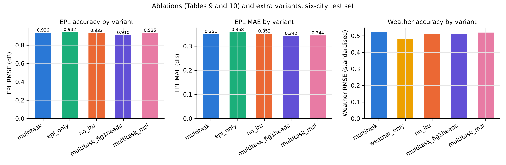
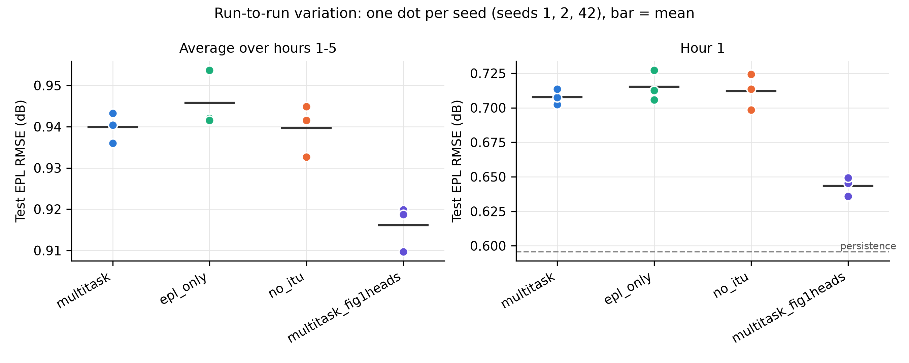

### 7.3 Uncertainty

The 95 % intervals cover 96.6 % of outcomes overall, close to nominal, but
this hides miscalibration: nominal 50 % intervals cover 77.8 %, nominal 99 %
cover 97.9 %; coverage is 99.4 % in dry hours (mean width 1.43 dB), 86.4 % in
hours with precipitation (4.95 dB) and 37.0 % at >= 2.5 mm/h (10.1 dB). By true
EPL, coverage falls from 99.3 % (0-1 dB) to 20.4 % (>= 10 dB). The intervals
widen when rain is likely, but not enough, and errors are heavier-tailed than
Gaussian. (Grouping by true weather/EPL is a diagnostic; it uses the outcome.)

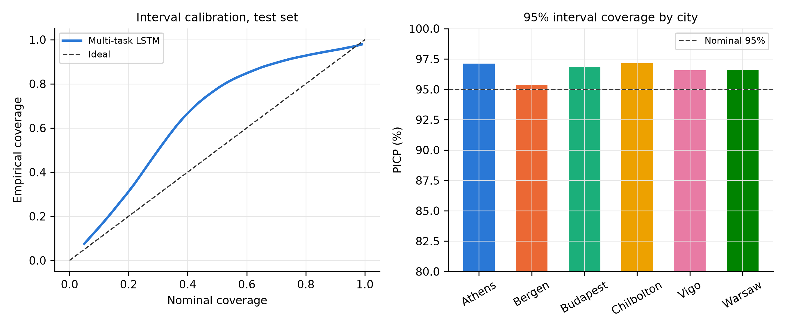

### 7.4 Unseen cities (seed 42, ten cities)

| Model / input mode | Error of period means | Hourly MAE | Hourly RMSE | PICP 95 % |
|---|---|---|---|---|
| Main, synthesized (paper method) | 0.189 | 0.622 | 1.214 | 85.1 % |
| Main, median of 3 neighbours | 0.151 | 0.536 | 1.160 | 84.1 % |
| Main, own weather | 0.373 | 0.615 | 1.122 | 94.7 % |
| MSL model, own weather | 0.049 | 0.340 | 0.890 | 93.1 % |
| Persistence of own EPL | 0.000 | 0.357 | 1.052 | - |
| *Paper (reference)* | *0.213* | - | - | - |

* Measured like the paper (absolute difference of period means), the
  synthesized-input error is close to the paper's value, but hour by hour
  the forecasts are worse than local persistence.
* With their own weather, Davos (error of means 2.25 dB) and Madrid (0.99 dB)
  fail with the surface-pressure model: their surface pressure (about 810-960
  hPa) lies outside the training range (946-1048 hPa). With MSL pressure the
  errors fall to 0.05 and 0.04 dB and the model beats local persistence on
  MAE and RMSE.

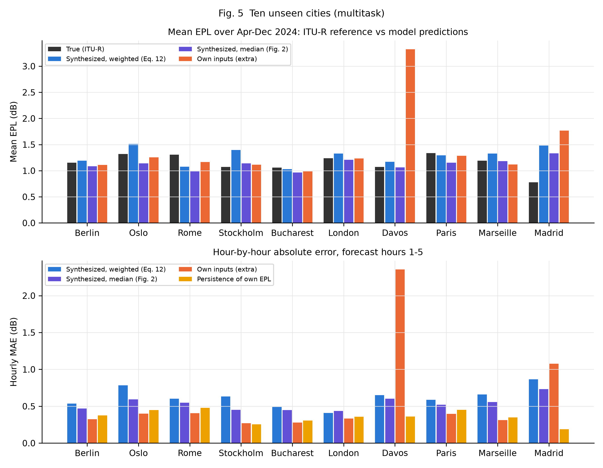
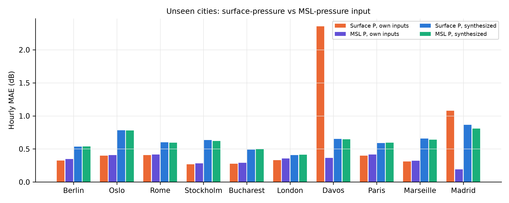

### 7.5 The minute-level reading of the paper

Linearly interpolating hourly ERA5 to 1-minute steps and forecasting five
minutes ahead (Fig. 2 reading): persistence RMSE 0.033 dB, linear
extrapolation 0.013 dB, the paper 0.026 dB, our LSTM 0.438 dB.

* Linear extrapolation is exact (error < 1e-5 dB) for anchors 5-55 minutes
  into an hour, because the interpolated series is a straight line within
  each hour; it errs only for anchors on the hour. 92.5 % of test windows
  are predicted to within 1e-4 dB. This is a property of how the data were
  constructed, not forecasting skill (verified in code and by a unit test).
* The LSTM fails on rare extremes: only 14 of 42,000 training windows exceed
  14 dB, and even on those training windows it predicts about 6 dB for a true
  16 dB with sigma about 9 dB. Its test RMSE is dominated by 68 windows (0.8 %)
  with errors above 1 dB.

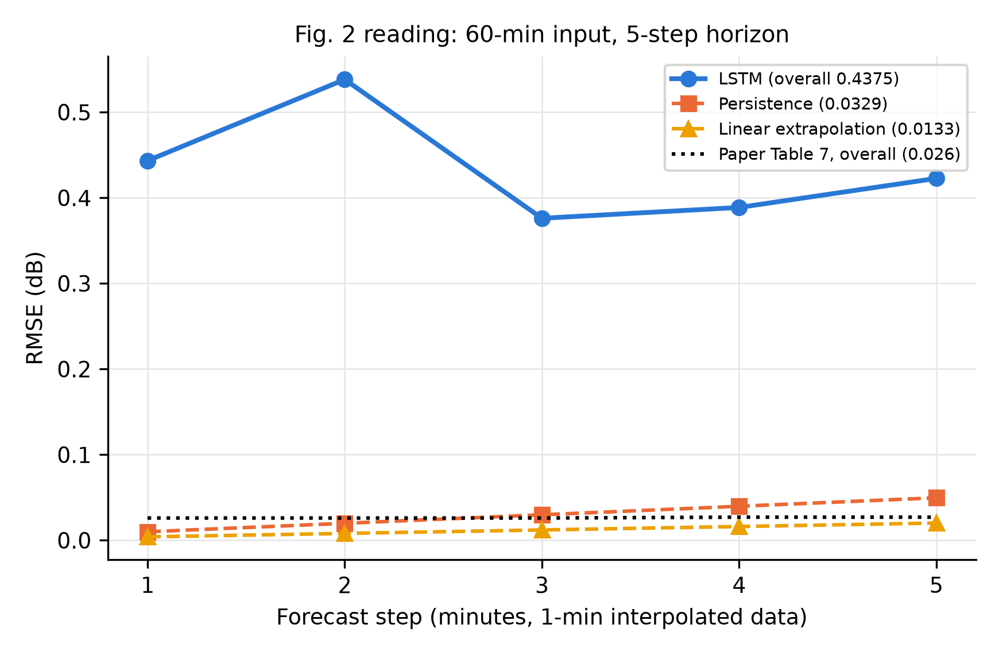

## 8. Why our findings differ from the paper

Supported by evidence:

* A 5-hour forecast of hourly ITU-R EPL built from ERA5 rain cannot plausibly
  reach 0.026 dB here: even persistence has 1.04 dB RMSE, because rain changes
  EPL by several dB within hours.
* Errors of the paper's size arise trivially on minute-interpolated data.

Hypotheses (not testable without the authors' data or code):

* The paper's 0.026 dB may correspond to a minutes-ahead forecast on
  interpolated data (consistent with its Fig. 2 and its almost flat per-hour
  RMSE in Table 7).
* Differences in labels: unspecified cloud proxy, sigma-feature definition,
  elevation and polarisation; different ITU-R versions (P.676-13/P.618-14 cited
  vs -12/-13 implemented).
* The paper's ablation gains (0.002 dB, 0.011 dB) are smaller than or similar
  to our seed-to-seed spread, so seed variation could explain them.

Unresolved: which pressure variable and which sampling interval the authors
actually used. Settling these would need the authors' dataset or code.

## 9. Limitations and threats to validity

* Labels are ITU-R model outputs from reanalysis weather, not link
  measurements (as in the paper).
* The cloud-water proxy is our own and weak; cloud attenuation is approximate.
* Hourly-mean rain rates are used in P.618, outside its intended use for
  rain-rate statistics; drizzle produces many small rain events.
* Heavy rain is rare in training and badly under-predicted; Gaussian
  intervals under-cover it and can extend below 0 dB.
* One test period (April-December 2024), six training cities, ten unseen
  cities; three seeds for four variants and one seed for the others; no
  formal significance tests.
* Unseen-city coordinates lie outside the training locations; unseen-city
  results use seed-42 models only.
* Fixed 30 deg elevation; no orbital geometry or scintillation.

## 10. Reproducibility

* Environment: Python 3.12, exact versions in `requirements.txt`.
* `.\run_pipeline.ps1 -Download` rebuilds everything from public data;
  `.\run_pipeline.ps1 -EvaluateOnly` re-evaluates existing checkpoints.
* Training is deterministic on the original machine (a 2-epoch retrain
  matched the original losses to 1e-7); finished runs are never overwritten.
* `evaluation/audit_results.py` recomputes all metrics (127/127 pass);
  `python -m unittest discover -s tests` runs 12 tests (all pass).
* Every run has a `run_config.json`; `results/paper/experiments_summary.json`
  lists all runs with seed, status, epochs, time and metrics.
* Not verified: a full run from an empty folder or on another machine.

## 11. Conclusion and future work

The pipeline, model and protocol of the paper can be rebuilt from public
data, but the central accuracy claim does not hold for a genuine 5-hour
forecast of hourly ITU-R path loss: the replicated model reaches about
0.92-0.94 dB RMSE, about 10 % better than persistence overall and worse than
persistence one hour ahead. The paper's ablation conclusions were not
reproduced, its unseen-city metric hides hourly errors, and nominal interval
coverage hides poor calibration in rain. Two concrete improvements emerged:
an extra Dense layer per head (consistent 0.024 dB gain over three seeds)
and mean-sea-level pressure for high-altitude sites.

Future work: obtain the authors' dataset to compare labels directly;
evaluate on measured link attenuation; handle rare heavy rain (re-weighting,
heavy-tailed or mixture likelihoods, quantile loss); recalibrate intervals
on validation data; more seeds and significance tests; and test the
remaining hypotheses (rain-only feature ablation, unseen-city evaluation
across seeds).

## 12. References and data attribution

See [REFERENCES.md](REFERENCES.md). Weather data by Open-Meteo.com (CC BY 4.0),
based on ERA5 (Copernicus Climate Change Service). Paper: El-Sayed et al.,
EURASIP J. Wireless Commun. Netw. 2026:102, doi:10.1186/s13638-026-02667-w
(CC BY-NC-ND 4.0).
