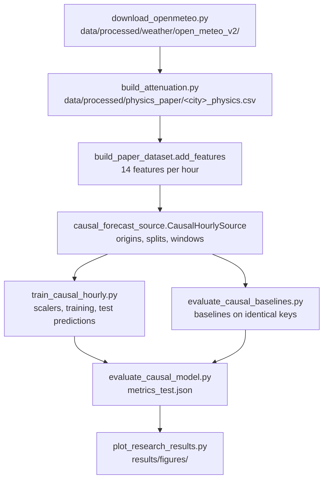

# The project explained from scratch

This guide teaches the whole project, from why satellite links fade to how
every number in the results is computed. It assumes basic Python and machine
learning (what a neural network, a loss function and a train/test split are),
but no knowledge of satellite communications.

Everything here describes **what the code actually does**, with the file and
function that does it. The main experiment is the **causal hourly evaluation**
(`causal_hourly_v1`). Earlier experiments are mentioned only to explain why
they are kept separate.

Contents:
* A. Problem and motivation
* B. Physics and weather data
* C. Data pipeline
* D. Model architecture
* E. Baselines and metrics
* F. Main results
* G. Repository walkthrough
* H. Limitations and next steps
* I. Viva and interview preparation

---

## A. Problem and motivation

### A.1 LEO satellites

A **low Earth orbit (LEO)** satellite orbits a few hundred to about 2,000 km
above the ground. Constellations such as Starlink use thousands of them for
broadband internet. Because they are close to Earth, the signal delay is
short. However, each satellite crosses the sky in minutes, and the radio
signal must pass through the whole atmosphere.

### A.2 Why the atmosphere weakens the signal

At **Q-band** (here **39 GHz**), the wavelength is under 1 cm. At these
frequencies, three things absorb or scatter energy:

1. **Gases.** Oxygen and water vapour absorb a little energy all the time.
2. **Clouds.** Tiny liquid droplets absorb energy in proportion to the amount
   of liquid water along the path.
3. **Rain.** Raindrops are comparable in size to the wavelength. They absorb
   and scatter strongly, and heavy rain can remove most of the signal.

The extra loss on top of ordinary free-space spreading is the **excess path
loss (EPL)**. In this project:

> EPL = gas attenuation + cloud attenuation + rain attenuation (in dB)

### A.3 Decibels

Attenuation is measured in **decibels (dB)**, a logarithmic unit:
loss_dB = 10 * log10(P_in / P_out).

| Loss | Power that remains |
|---|---|
| 3 dB | about half |
| 10 dB | one tenth |
| 20 dB | one hundredth |

Decibels turn multiplication into addition, which is why the three
components can simply be summed. All metrics in this project (RMSE, MAE) are
computed **in dB**, never in linear power.

### A.4 Why forecasting helps

Operators keep a fixed safety margin (often 3-5 dB) for bad weather, and this
wastes capacity in clear sky. A forecast of EPL 1-5 hours ahead could let a
system switch modulation, raise power or reroute traffic *before* a rain fade.

### A.5 What this project predicts, and what it does not

* **Predicts:** EPL in dB at +1, +2, +3, +4 and +5 hours after a forecast
  time, for six fixed European sites. Each forecast comes with an uncertainty
  estimate.
* **Also predicts:** five weather variables over the same 5 hours. This is
  an auxiliary task of the multi-task model.
* **Does not predict:**
  * measured satellite signals. The "true" EPL is computed from weather with
    physics models (Sect. B);
  * effects of satellite motion (Doppler, changing elevation), antennas or
    hardware;
  * anything at minute resolution.

---

## B. Physics and weather data

### B.1 ERA5 weather

**ERA5** is a reanalysis made by the European Centre for Medium-Range Weather
Forecasts (ECMWF). A reanalysis combines past observations with a weather
model to produce a consistent hourly record of the atmosphere on a grid. It
is not a direct station measurement, and it is published with a delay of
several days.

We download it through the free **Open-Meteo archive API**
(`data_pipeline/download_openmeteo.py`). The hourly variables, for 2020-2024
and each city's coordinates, are:

| Open-Meteo variable | Our column | Used for |
|---|---|---|
| `temperature_2m` | `temperature_C` | input feature, weather target, gas model |
| `relative_humidity_2m` | `relative_humidity_percent` | input, weather target, gas and cloud models |
| `dew_point_2m` | `dewpoint_C` | stored only; not a model input |
| `surface_pressure` | `pressure_hPa` | input, weather target, gas model |
| `precipitation` (rain + snow, mm in the past hour) | `precipitation_mm` | input, weather target, cloud proxy |
| `rain` (liquid only, mm in the past hour) | `rain_mm` | rain attenuation |
| `cloud_cover` | `cloud_cover_percent` | input, weather target |

Cloud *liquid water* is not available hourly from this source, so the cloud
model uses a proxy (B.3). No missing hours were found in the 30 city-years
(`docs/REPLICATION_GAP_AUDIT.md`, Sect. A).

### B.2 ITU-R recommendations

The **ITU-R** (radio sector of the International Telecommunication Union)
publishes standard models for radio propagation. We use them through the
`itur` Python library (version 0.4.0) and our own code in
`physics/build_attenuation.py`.

Fixed link settings (`config.py`):

| Setting | Value | Source |
|---|---|---|
| Frequency | 39 GHz | the paper |
| Elevation angle | 30 degrees | **our choice**: the paper says "fixed" but gives no value |
| Polarisation | circular (tilt tau = 45 degrees) | our choice |

The three components:

| Component | Recommendation | What the code computes (`physics/build_attenuation.py`) |
|---|---|---|
| Gas | P.676-12 | `gaseous_attenuation`: specific attenuation of oxygen and water vapour at the surface (line-by-line, Annex 1), using **dry-air** pressure and water-vapour density from T and RH. It is multiplied by equivalent heights (Annex 2) and divided by sin(30 deg) for the slanted path |
| Cloud | P.840-8 | `cloud_attenuation`: A = LWP x K_l / sin(30 deg). K_l (about 1.233 dB/km per g/m^3 at 39 GHz) is evaluated at 0 deg C. LWP comes from our proxy |
| Rain | P.838-3, P.618-13, P.839-4 | `rain_attenuation`: gamma_R = k R^alpha (P.838) gives dB/km for rain rate R. The rain height comes from P.839 and the station height from P.1511. P.618 steps 1-9 then convert gamma_R into an effective path length and an attenuation |

`compute_attenuation` adds the three into `epl_dB` and writes one table per
city: `data/processed/physics_paper/<city>_physics.csv`. The table also keeps
the intermediate quantities (slant path, gamma, reduction factors).

### B.3 The cloud proxy

The paper says liquid water path was "approximated using a simple proxy
derived from relative humidity and precipitation" but gives no formula. Our
proxy (`physics/lwp_proxy_calibration.json`) is:

> LWP = a * clip((RH - 65) / 35, 0, 1) + b * precipitation, with a = 0.101
> kg/m^2 and b = 0.144 kg/m^2 per mm.

* **How it was fitted:** to ERA5 cloud liquid water for Athens and Bergen,
  2020-2022 (`physics/calibrate_lwp_proxy.py`).
* **How good it is:** it is weak. On held-out data (Athens 2023-2024) its
  R^2 is about 0, and its correlation is 0.38.
* **What that means:** cloud attenuation in our labels is a rough estimate.
  It is small on average (0.06-0.22 dB per city), so it matters less than
  rain.

### B.4 Typical sizes

Means per city over 2020-2024 (Figure 12):

| Component | Mean per city | Behaviour |
|---|---|---|
| Gas | about 0.73-0.90 dB | Almost constant: a floor of about 0.75 dB |
| Cloud | 0.06-0.22 dB | Small |
| Rain | 0.11 dB (Athens) to 0.58 dB (Vigo, Bergen) | Zero in 79 % of hours, but up to 20.6 dB |

* The EPL median is 0.91 dB and its maximum is 25.6 dB (Figure 11).
* Rain causes almost all of the variability, so **forecasting EPL is mostly
  forecasting rain**.

### B.5 One important interpretation choice

P.618 is a *statistical* method. It predicts the attenuation exceeded 0.01 %
of an average year, from the rain rate exceeded 0.01 % of the time (R0.01).
We feed it the **hourly** rain rate in place of R0.01, for every hour. This
interpretation is common, but it is not stated in the paper.

* It follows the formulas exactly: the code matches `itur`'s own P.618
  function to 0.0 dB (`docs/RAIN_LABEL_DIAGNOSTIC.md`).
* It produces a long tail: about 1 % of hours above 6.7 dB, and a maximum of
  25.6 dB.
* The paper's plots stop near 6.7 dB, so the authors probably applied P.618
  differently. This is unverifiable.

### B.6 Why reconstructed labels are not measurements

Our EPL is the output of models applied to reanalysis weather. Real received
power would also include:
* local rain structure that ERA5's grid of about 25-30 km smooths out;
* scintillation and antenna wetting;
* errors in the ITU-R models themselves.

A model that forecasts our labels well is therefore forecasting **ITU-R
physics applied to ERA5**, not the real channel. Validation against measured
links (for example Alphasat at Chilbolton) would be needed for operational
claims.

---

## C. Data pipeline

### C.1 From raw data to windows



**The 14 input features** (`config.FEATURES`, built by
`data_pipeline/build_paper_dataset.add_features`):

| # | Feature | Meaning |
|---|---|---|
| 1-2 | `latitude`, `longitude` | Constant per city |
| 3-7 | `temperature_C`, `relative_humidity_percent`, `pressure_hPa`, `precipitation_mm`, `cloud_cover_percent` | Weather at that hour |
| 8, 10, 12 | `gas_mean`, `cloud_mean`, `rain_mean` | The attenuation component at that hour, in dB |
| 9, 11, 13 | `gas_std`, `cloud_std`, `rain_std` | Standard deviation of the component over the **trailing** 24 hours (pandas rolling window ending at that hour) |
| 14 | `elevation_deg` | Constant 30 |

### C.2 Forecast origins and windows

The class `CausalHourlySource` (`data_pipeline/causal_forecast_source.py`)
handles one city.

* **Forecast origin:** an hour *t* at which a forecast is made. *Every* hour
  with complete data is an origin; there is no subsampling.
* **Input window `X`:** the 14 features at hours t-59 ... t. The shape is
  (60, 14) per origin.
* **Targets `y`:** EPL at hours t+1 ... t+5. The shape is (5,) per origin.
* **Weather targets:** the 5 weather variables at t+1 ... t+5. The shape is
  (5, 5). These are built in `training/train_causal_hourly.py`.
* **Exclusions:** windows with any missing input or target value are
  excluded, never filled. In practice none were missing.

**Example:** for origin 2024-06-01 12:00, the inputs cover 2024-05-30 01:00
to 2024-06-01 12:00, and the targets are EPL at 13:00, 14:00, 15:00, 16:00
and 17:00 on 2024-06-01.

### C.3 Chronological split with gaps

For each city, the origins are sorted in time and split 70 / 15 / 15 into
train / validation / test. The first validation origin is then moved later
until its first input hour comes **after** the last training target hour, and
the same is done for the test set. Splits are therefore separated by at least
65 hours (60 + 5), and no hour is used by two splits.

Resulting boundaries for each city:

| Split | Origins | Origins per city | Total over 6 cities |
|---|---|---|---|
| Train | 2020-01-04 10:00 to 2023-07-03 18:00 | 30,633 | 183,798 |
| Validation | 2023-07-06 11:00 to 2024-04-02 06:00 | 6,500 | 39,000 |
| Test | 2024-04-04 23:00 to 2024-12-31 18:00 | 6,500 | **39,000** |

**Origins vs target values.** The test set has **39,000 origins**. Each has 5
horizons, giving **195,000 target values**. Metrics are averaged over the
195,000 values unless they are stated per horizon (39,000 values each).

### C.4 How leakage is prevented

*Leakage* means information from the future, or from the test set, reaching
the model. Here is how each route is closed:

| Possible leak | How it is closed | Evidence |
|---|---|---|
| Future values in the inputs | Inputs use rows t-59..t only; rolling sigma windows end at t | `tests/test_causal.py`: changing every value after t leaves the inputs unchanged |
| Overlapping windows across splits | Gap of at least 65 h | test `test_splits_do_not_share_input_or_target_rows` |
| Scaler statistics from test data | Feature scaler fitted on training input rows only (`fit_feature_scaler`); weather-target scaler on training target rows only (`fit_weather_scaler`) | test `test_scaler_ignores_validation_and_test_rows` |
| Model selection on test data | Early stopping and the checkpoint use validation loss only; the test set is predicted once, after training | `run_config.json`, field `model_selection` |
| Interpolation leak | No interpolation in this protocol | metadata `interpolation: none` |

**Caveat.** ERA5 is a reanalysis published days later. This is *retrospective*
causal evaluation: no future data are used, but the inputs would not exist in
real time.

### C.5 Earlier experiments, and why they are kept separate

| Experiment | What differs | Why not mixed with the main result |
|---|---|---|
| Stratified hourly (`data/processed/paper/`, `results/paper/`) | 10,000 stratified sample hours per city, as in the paper's text; 8,916 test windows | Different, smaller test set. Its RMSE (0.916 dB for the same architecture) is not on the same keys |
| Minute-interpolated (`paper_minute`, `minute_full_*`) | Hourly data linearly interpolated to 1-minute steps; forecasts 1-5 minutes ahead | Interpolation puts the *next* hour's value into the inputs (a leak, shown in `tests/test_causal.py`). It measures interpolation, not forecasting |
| Unseen cities | Ten other cities with inputs synthesised from neighbours (paper Eq. 12-13) | Evaluated only with the stratified models |

---

## D. Model architecture

### D.1 LSTM intuition

A **long short-term memory (LSTM)** layer reads a sequence one step at a time
and keeps an internal memory vector. Learned **gates** decide what to forget,
what to add and what to output at each step. This lets it carry information
such as "rain started 3 hours ago and humidity is rising" across many steps.
Stacking LSTM layers lets later layers work on more abstract patterns.

### D.2 The implemented network

The network is built by `build_model` in `training/train_paper_model.py`,
called with `head_hidden=256` (variant `multitask_fig1heads`):

```text
Input (60 hours x 14 features)
 -> LSTM(256, returns the full sequence) -> Dropout(0.2)
 -> LSTM(256, returns the full sequence) -> Dropout(0.2)
 -> LSTM(256, returns the last step only)  => shared 256-number summary
     |-> Weather head: Dense(256, ReLU) -> Dense(25) -> reshape to (5 hours x 5 variables)
     |-> EPL head:     Dense(256, ReLU) -> Dense(10)  = 5 means + 5 log-variances
```

Parameter count: **1,468,707**. This was checked by hand from the layer sizes:

| Part | Parameters |
|---|---|
| LSTM layers | 277,504 + 525,312 + 525,312 |
| Weather head | 65,792 + 6,425 |
| EPL head | 65,792 + 2,570 |

The EPL head is linear, so the means are directly in dB.

### D.3 Multi-horizon output

The model does not predict step by step. The last LSTM state goes through a
dense layer that outputs **all five horizons at once**: 5 means mu_k and 5
log-variances s_k. The standard deviation is sigma_k = exp(s_k / 2). The
log-variance is clipped to [-12, 6] for numerical safety.

### D.4 Loss and optimisation

* **EPL loss:** Gaussian negative log-likelihood (paper Eq. 10, function
  `gaussian_nll`):
  NLL = mean over values of 0.5 * (s + (y - mu)^2 / exp(s)), where s = log
  sigma^2.
  * The loss is small when mu is close to y.
  * It is also small when sigma honestly reflects the size of the error.
  * It is large when the model is confidently wrong.
  * The constant 0.5 log(2 pi) is omitted, so values can be negative.
* **Weather loss:** mean squared error on *standardised* weather targets.
* **Total loss:** 1.0 x weather MSE + 1.0 x EPL NLL.
* **Optimiser:** Adam, learning rate 1e-4, batch 128, up to 50 epochs,
  shuffled.
* **Early stopping:** after each epoch the validation loss is computed. The
  best model is saved (`models/causal_hourly_fig1heads_seed42/best.keras`).
  Training stops after 6 epochs without improvement, and the best weights are
  restored.
  * Here: 11 epochs were run, and **epoch 5** was best (validation loss
    -0.301).
  * After epoch 5, the training loss kept falling while the validation loss
    rose. This is overfitting.
  * Training took 3.1 h on a laptop CPU.

### D.5 Reproducibility

* The seed is 42 (`tf.keras.utils.set_random_seed`).
* TensorFlow op determinism is on, and the library versions are pinned in
  `requirements.txt`.
* On this machine, an earlier determinism check reproduced training losses
  to 1e-7 (recorded in the former `STATUS.md`: `git show 8f0b551:STATUS.md`).
  Other hardware or library versions may differ.
* Only one seed was trained for this protocol.

---

## E. Baselines and metrics

### E.1 Baselines

All baselines are computed in `evaluation/evaluate_causal_baselines.py` from
EPL values available at the forecast time t. They are scored on **exactly the
same 39,000 x 5 keys** as the model.

| Baseline | Forecast for t+k | Idea |
|---|---|---|
| Persistence | y(t) | "It stays as it is now" |
| Recent 24-h mean | mean of y(t-23 .. t) | Local climatology |
| Linear extrapolation | y(t) + k (y(t) - y(t-1)) | Continue the latest trend |

Persistence is hard to beat for short horizons, because weather changes
slowly most of the time. Beating it is the minimum requirement for a useful
forecaster.

### E.2 MAE and RMSE

For errors e_i = forecast_i - truth_i over n values:

* **MAE** = (1/n) sum |e_i|. This is the average size of an error.
* **RMSE** = sqrt((1/n) sum e_i^2). Errors are squared before averaging, so
  large errors count much more.
  * Example: one error of 10 dB adds 100 to the sum. That is as much as 100
    errors of 1 dB.

Implemented in `evaluation/evaluate_causal_model.metrics`. Errors are in dB.
"Pooled" means averaged over all 195,000 values; "per horizon" means over the
39,000 values of one horizon.

**Why RMSE and MAE tell different stories here.** Most hours are clear sky,
with tiny errors, and a few rain peaks have huge errors. MAE is dominated by
the many small errors. RMSE is dominated by the few large ones: the 1 % of
target values above 6.7 dB cause 53 % of the model's squared error
(`results/why_results_differ/error_budget.json`).

### E.3 Improvement over persistence

> improvement (%) = 100 x (metric_persistence - metric_LSTM) / metric_persistence

| Metric | Calculation | Improvement |
|---|---|---|
| RMSE | 100 x (1.0181 - 0.8592) / 1.0181 | 15.6 % |
| MAE | 100 x (0.3461 - 0.3350) / 0.3461 | 3.2 % |

The source, `metrics_test.json` (`model_vs_persistence`), stores these as
negative changes: -15.60 % and -3.20 %.

### E.4 Prediction intervals and calibration

The model outputs mu and sigma. A **central prediction interval** with
nominal coverage p is mu +- z_p sigma. For example, z = 1.96 for 95 % and
z = 0.674 for 50 %.

* **Empirical coverage:** the share of true values that fall inside the
  interval.
* **Calibrated:** empirical coverage equals nominal coverage, for every p and
  ideally **in every condition** (dry, light rain, heavy rain).
* **Overall vs conditional coverage:** overall 95 % coverage can look fine
  while being an average of over-wide intervals in clear sky and much too
  narrow intervals in rain. That is exactly what happens here.

### E.5 Why heavy rain matters most

Heavy rain causes the deep fades that actually break links. A forecaster that
is accurate in clear sky but misses rain peaks gives little operational value,
even if its average metrics look good.

---

## F. Main results (causal hourly evaluation)

Source: `results/causal_hourly_fig1heads_seed42/metrics_test.json` (verified by
recomputation in `evaluation/plot_research_results.py`).

| Method | RMSE (dB) | MAE (dB) |
|---|---|---|
| LSTM | 0.8592 | 0.3350 |
| Persistence | 1.0181 | 0.3461 |
| Recent 24-h mean | 1.1261 | 0.4940 |
| Linear extrapolation | 2.5186 | 0.7182 |

### What improves

* **By horizon:** the LSTM's RMSE is lower at every horizon. Its RMSE grows
  from 0.627 dB (+1 h) to 0.985 dB (+5 h), while persistence grows from
  0.648 to 1.209 dB. The gain is largest at +5 h (-0.223 dB) (Figure 5).
* **By city:** the LSTM's RMSE is lower in every city (Figure 7).
* **Light rain:** RMSE is 1.241 vs 1.678 dB. When rain is ending or
  fluctuating, persistence repeats a stale value and the LSTM does better.

### Why the MAE gain is smaller

* MAE is worse than persistence at +1 h (0.211 vs 0.191) and +2 h (0.302 vs
  0.295).
* MAE is also worse in dry hours (0.159 vs 0.129).
* **Why:** in steady clear sky, persistence is almost exactly right, while
  the LSTM adds small errors, for example from expecting rain that does not
  come.
* **Why RMSE still falls:** it rewards avoiding a few large errors, and the
  LSTM is better at that in light rain and at long horizons.

### The heavy-rain failure

In heavy rain (>= 2.5 mm/h at the target hour; 1,475 values):

| Metric | LSTM | Persistence |
|---|---|---|
| RMSE | 6.704 dB | 5.845 dB |
| MAE | 5.660 dB | 4.495 dB |

The LSTM is **worse** than persistence. Its largest prediction is 8.9 dB,
while true values reach 25.6 dB. Two reasons make this plausible:
* rain peaks are short and rare, so the model learns to stay near typical
  values;
* the NLL loss lets it "explain" big errors by inflating sigma instead of
  moving mu.

Figures 2, 3 and 8 show this.

### Uncertainty requires caution

Coverage of the 95 % interval:

| Group | Coverage | Mean width |
|---|---|---|
| All values | 97.4 % | 2.39 dB |
| Dry | 99.5 % | 1.66 dB |
| Light rain | 91.0 % | 4.95 dB |
| Heavy rain | **46.0 %** | 9.45 dB |

At nominal 50 %, coverage is 81.9 % overall.

* **Clear sky:** intervals are too wide (under-confident).
* **Heavy rain:** intervals are far too narrow (over-confident).

The overall 97.4 % looks good only because these two failures average out
(Figures 9, 10).

### One seed

This protocol was trained once. On the earlier stratified protocol, three
seeds of the same architecture varied by 0.004-0.007 dB, so a 0.159 dB gain
is unlikely to be seed noise. That has not been measured here, so no
statistical-significance claim is made.

### Why 0.026 dB is not comparable

The paper reports RMSE 0.026 dB. Our analysis
(`docs/WHY_RESULTS_DIFFER_FROM_PAPER.md`) found, in order of estimated
effect:

1. **A different forecasting task.** The paper's Fig. 2 and Fig. 4 suggest a
   series interpolated to 1 minute, with forecasts 1-5 *minutes* ahead
   (about 470,000 test samples). On that task, persistence and linear
   extrapolation on our labels already score 0.035 and 0.011 dB.
   Interpolation also leaks the next hour into the inputs. This is a
   hypothesis; it cannot be proven without the authors' code.
2. **Different labels.** Ours reach 25.6 dB; the paper's plots stop near
   6.7 dB, so its rain model was probably applied differently.
3. **Internal inconsistencies in the paper.** Its Table 7 overall (0.026)
   does not equal the mean (0.036) or the RMS (0.063) of its own per-city
   values.

No implementation bug was found on our side, and RMSE was verified to be in
physical dB.

---

## G. Repository walkthrough

### G.1 Path through the code

1. `config.py`: every setting, tagged [PAPER] (from the paper) or [OURS] (our
   choice).
2. `data_pipeline/download_openmeteo.py`: downloads hourly weather.
3. `physics/build_attenuation.py`: ITU-R labels into
   `data/processed/physics_paper/`.
4. `data_pipeline/build_paper_dataset.py`: `add_features` (the 14 features).
   It also builds the earlier stratified dataset.
5. `data_pipeline/causal_forecast_source.py`: causal origins, splits,
   windows and the scaler.
6. `evaluation/evaluate_causal_baselines.py`: baselines and the reference
   test keys in `results/causal_baseline_audit/`.
7. `training/train_paper_model.py`: `build_model`, `gaussian_nll`.
8. `training/train_causal_hourly.py`: trains the main model. It writes
   `models/causal_hourly_fig1heads_seed42/` and
   `results/causal_hourly_fig1heads_seed42/`.
9. `evaluation/evaluate_causal_model.py`: `metrics_test.json`.
10. `evaluation/plot_research_results.py`: the 13 figures in
    `results/figures/`.
11. `evaluation/why_results_differ.py`: label distribution, error budget and
    the paper comparison.
12. `tests/test_causal.py` and `tests/test_pipeline.py`: 41 unit and leakage
    tests.

### G.2 Commands (Windows PowerShell, repository root)

| Purpose | Command | Status |
|---|---|---|
| Environment | `py -3.12 -m venv .venv` then `.venv\Scripts\python -m pip install -r requirements.txt` | `.venv` exists here; a fresh install was not re-tested |
| Tests | `.venv\Scripts\python -m unittest discover -s tests` | Verified: 41 tests pass |
| Check the saved metrics and redraw the figures | `.venv\Scripts\python evaluation\plot_research_results.py --overwrite --export-docs` | Verified; stops if the metrics do not match `metrics_test.json` |
| Locate the results | `results\causal_hourly_fig1heads_seed42\metrics_test.json`, `results\figures\` | Present |

`evaluate_causal_model.py`, `evaluate_causal_baselines.py` and
`why_results_differ.py` refuse to overwrite their existing outputs. Re-running
them in place exits without changes, by design.

---

## H. Limitations and next steps

### Current limitations

* **Reconstructed labels:** ITU-R models on ERA5, not measured received
  power.
* **Assumptions:** the elevation (30 degrees), the cloud proxy (weak) and
  the way P.618 is applied to hourly rain are our choices.
* **One seed** for the main experiment.
* **Heavy rain:** worse than persistence; intervals cover only 46 %.
* **Short horizons:** MAE is worse than persistence at +1 and +2 h.
* **Retrospective inputs:** ERA5 is not available in real time.
* **Unseen cities:** not evaluated under the causal protocol.
* **The paper:** its exact protocol is unknown, so no reproduction claim is
  possible.

### Possible future work (not done)

1. Seeds 1 and 2 on the causal protocol (about 3 h each on CPU).
2. Rolling-origin (walk-forward) validation over several test years.
3. Validation on measured links, such as Alphasat Q/V-band beacon data.
4. Heavy-rain modelling: heavy-tailed or quantile losses, re-weighting of
   rare events, precipitation-nowcast inputs.
5. Conditional calibration: per-regime recalibration, or conformal
   intervals.
6. Stronger baselines: gradient boosting on the same features, or a
   numerical weather forecast as input.
7. Per-city and per-regime comparisons with confidence intervals.

---

## I. Viva and interview preparation

### I.1 Likely questions (concise answers)

1. **What does your model predict?**
   EPL at 39 GHz in dB, 1-5 hours ahead, for six European sites, with a
   Gaussian uncertainty. It also forecasts five weather variables.
2. **What is EPL?**
   The extra loss beyond free-space spreading. Here it is the sum of gas,
   cloud and rain attenuation.
3. **Where do the labels come from?**
   ITU-R models (P.676, P.840, P.838/P.618/P.839) applied to hourly ERA5
   weather. They are not measurements.
4. **Why 39 GHz?**
   The paper studies Q-band. At this frequency rain attenuation is severe,
   which is what makes forecasting valuable.
5. **What are the inputs?**
   60 hours x 14 features: location, five weather variables, three
   attenuation components with their 24-h rolling standard deviations, and
   elevation.
6. **Why an LSTM?**
   It processes sequences and keeps memory of the recent weather evolution.
   It is also the architecture in the paper.
7. **How many parameters?**
   1,468,707.
8. **What loss do you use?**
   Gaussian NLL for EPL (mean and log-variance) plus MSE for the
   standardised weather targets, weighted 1:1.
9. **How did you choose the epoch?**
   Early stopping on validation loss with patience 6. Epoch 5 was best out
   of 11.
10. **How did you split the data?**
    Chronologically per city, 70/15/15, with gaps of at least 65 hours so
    that no hour appears in two splits.
11. **How many test samples?**
    39,000 forecast origins x 5 horizons = 195,000 target values.
12. **What is persistence?**
    Forecasting that EPL stays at its current value for all five hours.
13. **What is your main result?**
    RMSE 0.859 dB vs persistence 1.018 dB (15.6 % lower); MAE 0.335 vs
    0.346 dB (3.2 % lower).
14. **Why is the MAE gain much smaller?**
    In clear sky, persistence is nearly perfect and the LSTM adds small
    errors. The LSTM's advantage is in avoiding some large errors, which
    RMSE weights heavily.
15. **Where does the model fail?**
    Heavy rain, where its RMSE is 6.70 dB against 5.85 dB for persistence.
16. **Is the uncertainty calibrated?**
    Not conditionally. 95 % intervals cover 97.4 % overall, 99.5 % in dry
    hours and only 46 % in heavy rain.
17. **Why not compare directly with the paper's 0.026 dB?**
    The forecasting task, the labels and possibly the metric definition
    differ, and the authors' data are unavailable.
18. **Did you find bugs in your code?**
    No bug explains the gap. Units, target alignment, the EPL sum and the
    metric were verified independently. Earlier bugs (for example Kelvin vs
    Celsius in P.840) were fixed and tested.
19. **What elevation did you use, and why?**
    30 degrees. The paper gives none. The clear-sky floor of about 0.5 dB in
    the paper's Fig. 3 is consistent with roughly 30 degrees, but this is
    inferred.
20. **How do you know there is no leakage?**
    Unit tests change all future values and check that the inputs do not
    change. Scalers use training rows only. Splits are gapped. The test set
    was predicted once, after model selection.
21. **What does the weather head add?**
    It is the multi-task part of the paper's design. On the earlier
    protocol, multi-task training gave at most a small EPL gain (0.006 dB).
22. **What would you do next?**
    More seeds, better heavy-rain modelling and conditional calibration, and
    validation on measured satellite data.

### I.2 Deeper questions

1. **"Your inputs include rain attenuation at time t, computed from the same
   physics as the target. Isn't that leakage?"**
   No. Those values are at or before the forecast time. They are known
   functions of past weather, and the target is the *future* EPL. Rain at
   t+1..t+5 is never used. The earlier `no_itu` ablation (stratified
   protocol) showed that removing these features barely changes RMSE.
2. **"Why is a reanalysis 'causal' if it is published days later?"**
   The evaluation is causal in the sense that no data timestamped after t
   are used. It is not operational: in real time you would need forecasts
   or nowcasts as inputs. We state this explicitly.
3. **"Persistence beats you at +1 h on MAE. Is the model useful?"**
   Partly. It improves RMSE at every horizon and MAE from +3 h. At very
   short horizons a hybrid (persistence plus a learned correction) might be
   better. Usefulness for fades is limited by the heavy-rain weakness.
4. **"Overall 95 % coverage is 97.4 %. Why do you say the uncertainty is
   poor?"**
   Calibration should hold conditionally. The intervals are too wide in
   clear sky (99.5 %) and much too narrow in heavy rain (46 %), exactly
   where a link decision depends on them.
5. **"Could the paper's 0.026 dB be correct?"**
   It may be correct for *their* protocol and labels. Our evidence suggests
   a much easier task: a minute-interpolated series forecast minutes ahead,
   where trivial baselines reach 0.01-0.05 dB. This is a hypothesis, not
   proof, and it does not imply misconduct.
6. **"Your labels have a 25.6 dB maximum. Is that physical?"**
   It follows from applying P.618 with an hourly rate of about 11 mm/h used
   as R0.01, at 30 degrees elevation. That is a valid formula evaluation but
   a debatable interpretation of a statistical method. A different, equally
   undocumented choice would shrink the tail.
7. **"Why not tune the elevation or rain model to match the paper?"**
   That would fit the labels to a published number rather than to physics.
   It would be tuning to the target.

### I.3 60-second explanation

> "I built a deep-learning forecaster for satellite link loss at 39 GHz. I
> take hourly weather from the ERA5 reanalysis for six European cities and use
> ITU-R propagation models to compute how much the atmosphere, mainly rain,
> would weaken the signal. A three-layer LSTM looks at the past 60 hours and
> predicts the loss for each of the next five hours, with an uncertainty. On a
> strictly time-ordered test set of 39,000 forecasts, it reduces RMSE by 15.6 %
> compared with simply repeating the current value. But it is worse than that
> simple baseline in heavy rain, and its uncertainty is unreliable there. I
> also investigated why a published paper reports about 30 times smaller errors and
> found strong evidence that it evaluated a much easier, minute-interpolated
> task."

### I.4 Technical explanation for an ML or research interviewer

> "It's a multi-horizon probabilistic sequence regression. Inputs are 60 x 14
> hourly windows. Targets are EPL at +1 to +5 h, built from ITU-R models on
> ERA5. The architecture is a 3 x 256 LSTM encoder with two dense heads: one
> predicts a Gaussian mean and log-variance per horizon, trained with
> negative log-likelihood, and an auxiliary head forecasts standardised
> weather with MSE. I built a causal evaluation: every hourly origin,
> chronological per-city splits gapped by the window length, scalers fitted
> on training rows, and unit tests that perturb future values. All baselines
> are on identical keys. The model gets 0.859 dB RMSE vs 1.018 for
> persistence, but the error distribution is heavy-tailed: 1 % of targets
> cause 53 % of the squared error, and the model under-predicts those
> extremes. Calibration is fine on average but conditionally poor: 46 %
> coverage in heavy rain. It's one seed, and the labels are simulated, so I
> present it as a methodological result rather than an operational one."

### I.5 Claims to avoid

* "We reproduced the paper" or "our model matches the paper."
* "The paper is wrong" or "the authors leaked data." Say instead: our evidence
  suggests a different protocol, and some reported values are internally
  inconsistent.
* "The model predicts real satellite signal loss." It predicts reconstructed
  labels.
* "The improvement is statistically significant." There is one seed and no
  significance test.
* "The uncertainty is well calibrated." That is only true on average, not in
  rain.
* "The model handles heavy rain." It does not; persistence is better there.
* "This could be deployed operationally." The inputs are retrospective, and
  there is no measured validation.
* "15.6 % better on every metric." The MAE gain is 3.2 %, and MAE is worse
  at +1 and +2 h.
